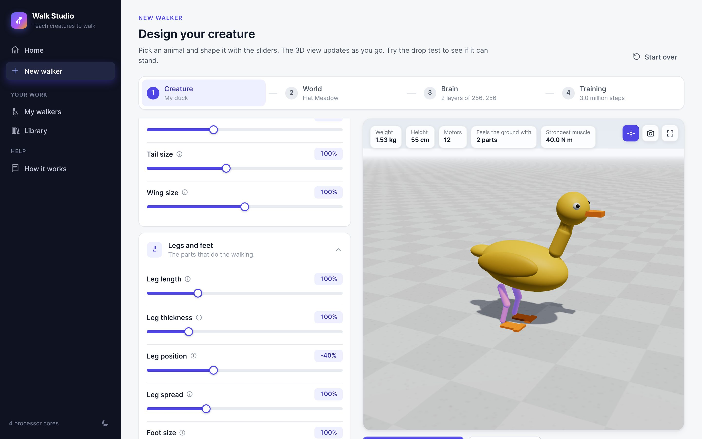
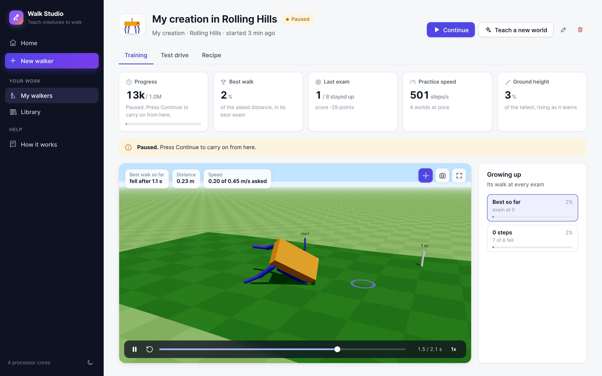

# Walk Studio

Design a creature, build its world, shape its brain, and watch it teach itself to walk. Everything happens in your web browser with sliders, switches and a live 3D view. You never need to open a code file.

Walk Studio is a point-and-click version of the [learn_to_walk](https://github.com/pacomc999/learn_to_walk) project: the same physics (MuJoCo), the same learning (PPO with a left/right symmetric brain), and the same duck, now with a puppy, a build-your-own creature kit and nine worlds to train in.

## Starting it

You need **Python 3.12** (from [python.org](https://www.python.org/downloads/); on Windows, tick "Add python.exe to PATH" during installation).

- **Windows:** double-click `Start Walk Studio.bat`.
- **macOS:** double-click `Start Walk Studio.command` (the first time, right-click it and choose Open).
- **Linux:** run `./start_studio.sh`.

The first start downloads the physics and learning libraries (about 1 GB), which takes a few minutes. After that it starts in seconds. Your browser opens the studio at `http://127.0.0.1:8770`. Keep the small black window open while you use it; closing it pauses any training (you can continue later).

## What you can do

**1. Design a creature.** Pick the **duck** (two webbed feet and a bendy neck), the **puppy** (four legs, a nodding head and a wagging tail), or **build your own** from sticks, balls and plates joined by motors. Every slider updates the 3D view: longer legs, bigger feet, a heavier body, stronger muscles, how far each joint bends, colours. Hover over a slider and the parts it changes light up. The **drop test** shows whether its muscles can hold it up.

**2. Choose its world.** Nine ready-made worlds, and you can change everything about them and save your own:

| World | What it is |
|---|---|
| Flat Meadow | Smooth grass: the place for first steps |
| Cobblestone Street | Square stones and bumps up to 3 cm (learn_to_walk's floor) |
| Running Track | Flat, but asked for speeds up to a run |
| Rolling Hills | Long smooth hills up to 25 cm, up and down |
| Grand Staircase | Flights of steps up and down |
| Frozen Lake | Slippery ice |
| Moon Base | Low gravity and dusty craters |
| Stormy Crossing | Gusts of wind and rocks thrown from the side |
| Rocky Canyon | Big flat-topped rocks of different heights |

You also decide what the walker cares about: points for walking at the asked speed, for staying up, for saving energy, for walking straight, and a switchable penalty for leaning on its joint limits.

**3. Shape its brain.** Choose ready-made sizes or add and remove layers of thinking cells, pick how cells respond, decide what it can sense (its feet touching the ground, the ground ahead), and whether its left and right side share one mirrored way of thinking. A diagram shows the network as you change it.

**4. Train and watch.** Pick a length (a quick taste, an evening, or overnight) and press Start. The walker practises in several worlds at once and takes a fixed exam every so often. The dashboard shows its progress in plain words and charts. You can watch its best walk in 3D and scroll through **every exam** to see how it grew up. Pause and continue at any time.

**Test drive.** Take any trained walker into any world, even ones it never practised in, at any speed. A blue ring moves at the asked speed so you can see if it keeps up.

**Teach a new world.** Start a new training from a walker's best brain, for example from flat ground onto the stairs.

## How long training takes

On a laptop with 8 processor cores the studio practises roughly 1,000 to 2,000 steps per second. The standard duck needed about 1.5 to 3 million steps to walk in learn_to_walk (an hour or so); the puppy usually balances sooner. The Training step estimates the time on your computer and gets more accurate after your first run.

## Where your work is kept

Everything you make goes into the `library` folder next to the studio: saved creatures, worlds and brain designs, and one folder per training with its brains, charts and 3D replays. It is plain files, so you can back it up or copy it to another computer.

## For developers

- `studio/creatures/`: the animals (`duck.py`, `puppy.py`) and the parts kit (`custom.py`); each turns a dictionary of settings into MuJoCo XML
- `studio/worlds.py`, `studio/world_templates/`, `studio/terrain.py`: worlds and ground shapes
- `studio/env.py`: the Gymnasium environment for any animal in any world
- `studio/brain.py`, `studio/mirror.py`: brain designs and the left/right symmetric policy
- `studio/train.py`: one training session (its own process); `studio/manager.py` starts and follows them
- `studio/server.py`: the local web server and its JSON API; `studio/web/`: the page (plain JavaScript and three.js, no build step)
- Tests: `python -m pytest`

See `CLAUDE.md` for more detail.
