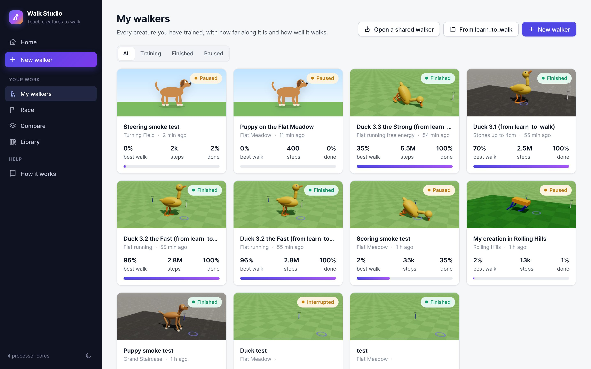
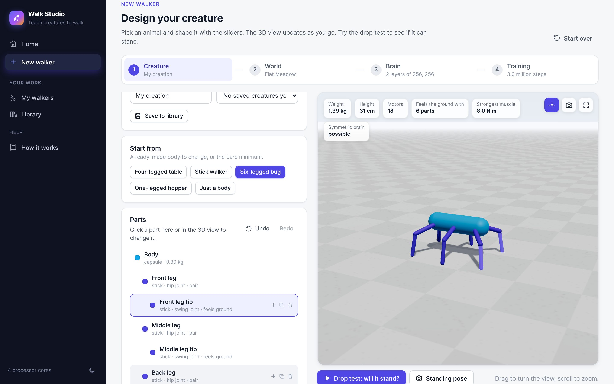
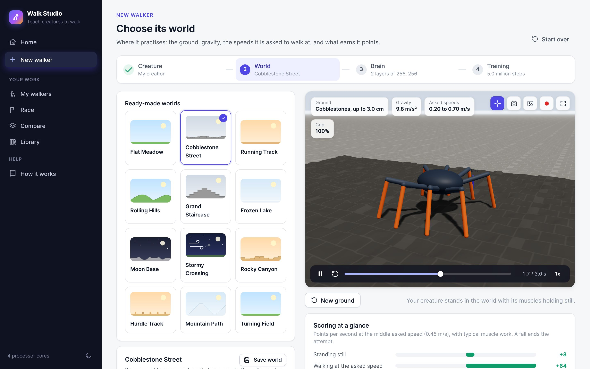
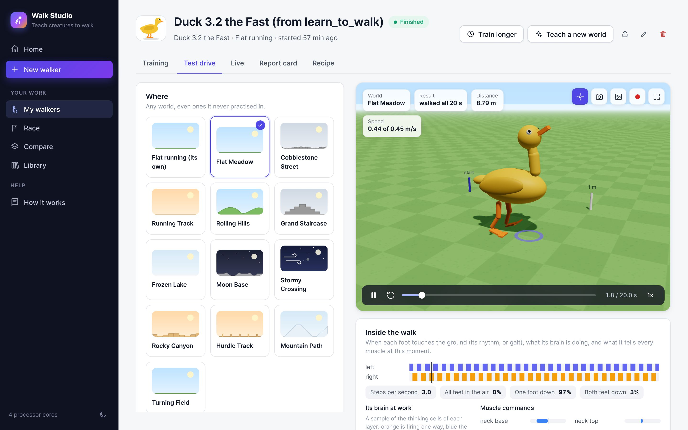
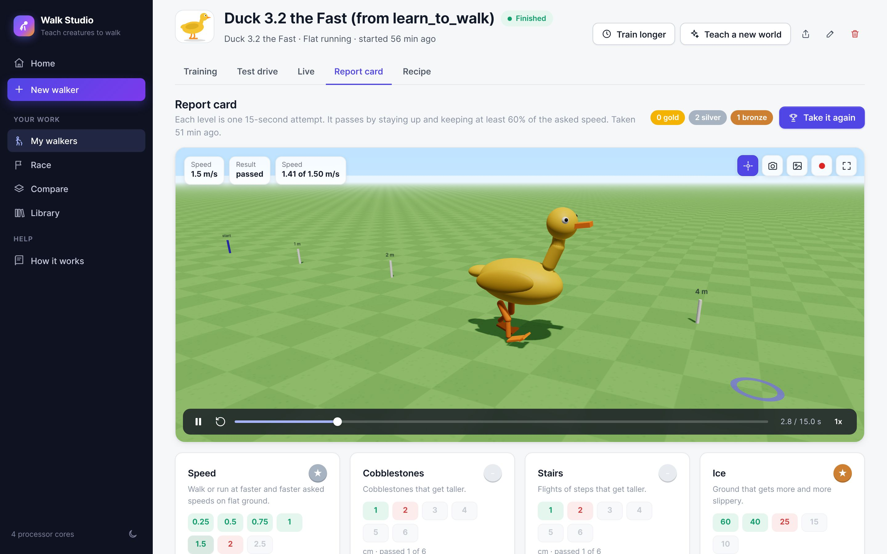
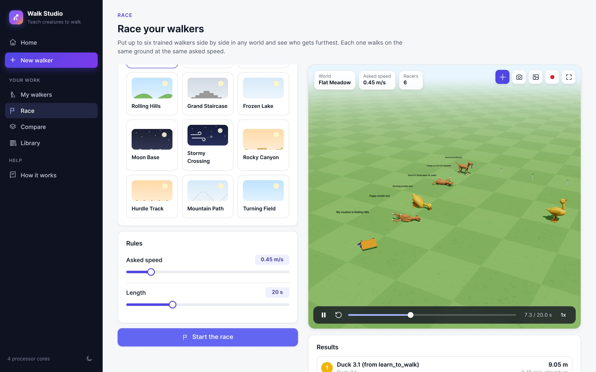

# Walk Studio

Design a creature, build its world, shape its brain, and watch it teach itself to walk. Everything happens in your web browser with sliders, switches and a live 3D view. You never need to open a code file.

Walk Studio is a point-and-click version of the [learn_to_walk](https://github.com/pacomc999/learn_to_walk) project: the same physics (MuJoCo), the same learning (PPO with a left/right symmetric brain), and the same duck, now with a puppy, a build-your-own creature kit (with ready-made bodies from a four-legged table to an eight-legged spider and a kangaroo) and twelve worlds to train in.

## In the browser, with nothing to install

The `studio/web` folder is the whole studio as a plain website: the physics (MuJoCo's official WebAssembly build, the same version as the Python studio), the learning (PPO on the graphics card with TensorFlow.js, WebGPU or WebGL) and the practice (background workers, one per processor core) all run in the visitor's browser. Any static web host can serve it, and GitHub Pages publishes it from this branch (`.github/workflows/pages.yml`).

- Try it locally: `python -m http.server 8772 --directory studio/web`, then open `http://127.0.0.1:8772`.
- Walkers, creatures and worlds are kept in that browser's own storage, on that computer only. Share a walker with the share button (a `.walker` file) and open it anywhere with **Open a shared walker**.
- Training runs while the tab is open. Closing the tab pauses it; press **Continue** to carry on from its last save.
- Walkers trained in the Python studio come over with `python -m studio.export_web walker <walker id or folder>`, which writes a `.walker` file the browser opens. Bringing ducks over from learn_to_walk still needs the Python studio (import there, then convert).

## Starting it

You need **Python 3.12** (3.11 or 3.13 work too; from [python.org](https://www.python.org/downloads/); on Windows, tick "Add python.exe to PATH" during installation).

- **Windows:** double-click `Start Walk Studio.bat`.
- **macOS:** double-click `Start Walk Studio.command` (the first time, right-click it and choose Open).
- **Linux:** run `./start_studio.sh`.

The first start downloads the physics and learning libraries (about 1 GB), which takes a few minutes. After that it starts in seconds. Your browser opens the studio at `http://127.0.0.1:8770`. Keep the small black window open while you use the studio. A training that is running carries on in the background even if you close the window, and keeps the computer from going to sleep; start the studio again to follow it or pause it.

## What you can do

**1. Design a creature.** Pick the **duck** (two webbed feet and a bendy neck), the **puppy** (four legs, a nodding head and a wagging tail), or **build your own** from sticks, balls and plates joined by motors. Every slider updates the 3D view: longer legs, bigger feet, a heavier body, stronger muscles, how far each joint bends, colours. Hover over a slider and the parts it changes light up. The **drop test** shows whether its muscles can hold it up.

**2. Choose its world.** Twelve ready-made worlds, and you can change everything about them and save your own:

| World | What it is |
|---|---|
| Flat Meadow | Smooth grass: the place for first steps |
| Cobblestone Street | Square stones and bumps up to 3 cm (learn_to_walk's floor) |
| Running Track | Flat, but asked for speeds up to a run |
| Rolling Hills | Long smooth hills up to 25 cm, up and down |
| Grand Staircase | Flights of steps up and down |
| Frozen Lake | Slippery ice |
| Moon Base | Low gravity and dusty craters |
| Stormy Crossing | Gusts of wind and rocks thrown from the side |
| Rocky Canyon | Big flat-topped rocks of different heights |
| Hurdle Track | Low bars across the track to step over |
| Mountain Path | Long even climbs and descents |
| Turning Field | Flat grass where it is asked to turn left and right: train here to steer it |

You also design its **scoring**: points for moving forward (exactly at the asked speed, close to it, or as fast as possible), for staying up, for saving energy, for walking straight, a cost for falling, and optional style rules, each with an on/off switch and a strength: no leaning on joint limits, keep the body level, stand tall, smooth moves, lift its feet, face forward, steady ride. **Scoring at a glance** shows what standing still, walking, crouching and rushing are worth under your rules, and warns you about the traps (when standing still or falling on purpose pays better than walking). During training, a chart shows where its points come from.

**3. Shape its brain.** Choose ready-made sizes or add and remove layers of thinking cells, pick how cells respond, decide what it can sense (its feet touching the ground, the ground ahead), and whether its left and right side share one mirrored way of thinking. A diagram shows the network as you change it.

**4. Train and watch.** Pick a length (a quick taste, an evening, or overnight) and press Start. The walker practises in several worlds at once and takes a fixed exam every so often. The dashboard shows its progress in plain words and charts. You can watch its best walk in 3D, scroll through **every exam** to see how it grew up, or play them all as a captioned **growing-up film** (and record it as a video). Pause and continue at any time.

**Test drive.** Take any trained walker into any world, even ones it never practised in, at any speed. A blue ring moves at the asked speed so you can see if it keeps up. Below the 3D view, **Inside the walk** shows when each foot touches the ground (its gait) and what the brain tells every muscle, moment by moment.

**Live.** Let a trained walker go in real time: change the asked speed with a slider or the arrow keys, push it from the side and watch it recover, or try it in another world. learn_to_walk's drive tool, in the browser. A walker trained in a world that asks it to turn (such as the Turning Field) can be **steered** with the left and right arrow keys.

**Report card.** Seven challenge ladders (speed, cobblestones, stairs, ice, a backpack, wind, other planets) that hand out medals, with every attempt to watch.

**Race.** Put up to six trained walkers side by side in any world and see who gets furthest.

**Teach a new world.** Start a new training from a walker's best brain, for example from flat ground onto the stairs.

**Bring over your learn_to_walk ducks.** On My walkers, point the studio at your learn_to_walk folder and every catalogue duck with a kept brain becomes a walker here (its body, world and brain come along), ready to test drive in the new worlds, race, or teach a new world. They walk as well as they did there: Duck 3.3 takes the studio's exam with no falls, as in his catalogue card.

**Share a walker.** The share button on a walker's page saves it as one `.walker` file (its recipe, brain, charts and replays). Anyone with Walk Studio can open it with Open a shared walker on My walkers.

**Courses.** On the Training step, add stages: after its own world it moves on to more worlds, one after the other, with the same brain (flat ground, then cobblestones, then stairs).

**Pictures and videos.** Every 3D view has buttons to save a picture or record a video to share.

## How long training takes

On a laptop with 8 processor cores the studio practises roughly 1,000 to 2,000 steps per second. The standard duck needed about 1.5 to 3 million steps to walk in learn_to_walk (an hour or so); the puppy usually balances sooner. The Training step estimates the time on your computer and gets more accurate after your first run.

## Where your work is kept

Everything you make goes into the `library` folder next to the studio: saved creatures, worlds and brain designs, and one folder per training with its brains, charts and 3D replays. It is plain files, so you can back it up or copy it to another computer.

## For developers

- `studio/creatures/`: the animals (`duck.py`, `puppy.py`) and the parts kit (`custom.py`); each turns a dictionary of settings into MuJoCo XML
- `studio/worlds.py`, `studio/world_templates/`, `studio/terrain.py`: worlds and ground shapes
- `studio/env.py`: the Gymnasium environment for any animal in any world
- `studio/brain.py`, `studio/mirror.py`: brain designs and the left/right symmetric policy
- `studio/train.py`: one training session (its own process); `studio/manager.py` starts and follows them
- `studio/server.py`: the local web server and its JSON API; `studio/web/`: the page (plain JavaScript and three.js, no build step)
- Tests: `python -m pytest`

See `CLAUDE.md` for more detail.
