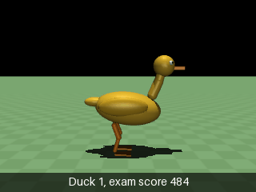

# Duck 1

**Symmetric brain, trained from zero**

Started 2026-10-29 11:06. Starts from: zero (a new brain; no plain brain was converted).

## What changed and why

The brain is built left/right symmetric (the NET method of Abdolhosseini and others 2019): one network reads the situation and its mirror image, and the left leg commands of the mirrored view drive the right leg. The judge (critic) and the sense scaling are symmetric too, and each left/right motor pair shares one wobble.

The best plain brain (night run 1, 4M steps: exam 905, no falls) hopped with the right leg always leading and used the left leg as a passive prop. Francisco wants two legged walking to appear by itself, without a rhythm clock or copied motion, so symmetry is built into the brain instead of rewarded with an extra tuned number.

## Recipe

- Brain: SymmetricPolicy, actor layers [256, 256], judge layers [256, 256], starting wobble log_std -1.0
- Reward per step: forward 3.0 per m/s up to the target speed, alive 0.2, energy 1.5 per joule, sideways 0.5 per metre
- Target speed: random from 0.2 to 0.7 m/s per attempt; attempts last 20 s
- Start: standing pose, each joint nudged randomly by up to 0.02 rad, no stride stance
- PPO: n_steps 1024, batch_size 256, n_epochs 10, learning_rate 0.0003, gamma 0.99, gae_lambda 0.95, clip_range 0.2
- Step size: fixed at the PPO learning rate for the whole run
- Code version: 43acb18

## Training history

- `runs/pilot_symmetric_stopped` (2026-10-29 11:06 to 11:08, 0 only): first start, stopped after two minutes; not used
- `runs/pilot_symmetric` (2026-10-29 11:14 to 13:18, 0 to 6.0M): planned as a 1M pilot, then continued to 2M and 6M. Alternating steps with real knee bends appeared by 1.6M. Exam best at 1.61M (484, 7 falls of 12), then a collapse: 12 of 12 falls from 4.25M on, 22 points at 6M
- `runs/measure_1.6M` (2026-10-29 15:35 to 16:09, 1.61M to 3.5M): rerun from 1.61M with the new exam and PPO stats. Exam swung between 164 and 439. Each brain update was 50 to 100 times bigger than PPO is designed for (approx_kl 0.5 to 1.1, safety limit hit by 83 to 87% of moves), growing as the wobble shrank. Likely cause of the collapse: a fixed step size

## Best brain

- From `runs/pilot_symmetric` at 1,605,632 steps (measured 2026-10-29 16:36)
- Exam (12 fixed attempts, no wobble): score 484, falls 7 of 12
- Walking test: 8 of 10 attempts walked
- At 0.4 m/s: speed 0.45 m/s, 34.6 J per metre, feet in the air 8%, one foot down 88%, both down 4%

## Notes

Walks with alternating steps, one foot down about 88% of the time. Passes the walking test at 0.4 m/s (8 of 10), but is fragile at other speeds: 7 of 12 exam attempts (random target speeds) end in a fall. Uses about twice the energy per metre of the plain hopper. Knee swing about 65 degrees, foot lift 6 to 7 cm. Code version: training ran on c32d242; the recipe above was read at 43acb18, which only adds the exam and stats (no change to how the duck learns).
